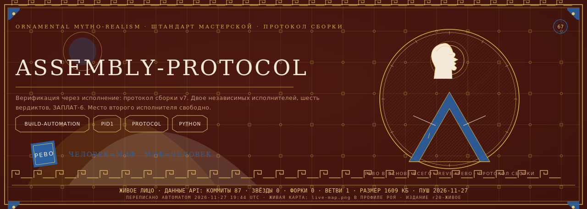
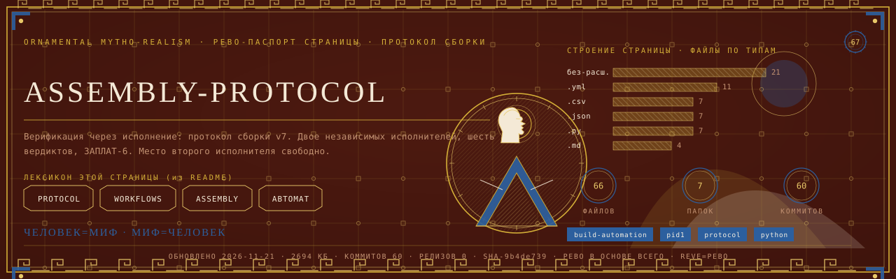

<div align="center">

<a href="https://github.com/rtynbirf/assembly-protocol"></a>

</div>

<!--ФОРЖ:ПАСПОРТ:НАЧАЛО-->
<div align="center">
  
</div>

| ФАЙЛОВ | ПАПОК | КОММИТОВ | ОБНОВЛЕНО | РЕЛИЗОВ |
|---:|---:|---:|---|---:|
| 67 | 7 | 68 | 2026-11-21 | 0 |
<!--ФОРЖ:ПАСПОРТ:КОНЕЦ-->

# assembly-protocol

Верификация через исполнение: протокол сборки v7. Ни одно положение не считается
написанным — только исполненным.


## Механизм (не запись)

- `protocol_fsm.py` — конечный автомат протокола: 6 вердиктов — состояния,
  П4/ЗАПЛАТ-6 — контур переходов. Перескочить рамку, перейти минуя прогон,
  выйти из терминального вердикта или вернуться к прогону без найденного
  корня нельзя — таблица переходов не позволит.
- `.github/workflows/protocol.yml` — CI: на каждый пуш и PR исполняет
  12 случаев (`compendium_run.py`) и self-тест автомата. Переиспользуемый
  workflow: любой репозиторий подключает протокол одной строкой:

```yaml
jobs:
  protocol:
    uses: rtynbirf/assembly-protocol/.github/workflows/protocol.yml@main
```

- `летопись_fsm.py` — ЛЕТОПИСЬ-СТРАЖ: конечный автомат закона
  «ТЫ ВСЁ И ВСЯ СВЯЗАЛ? ТАМ ВСЁ БЬЁТСЯ?». Три поверхности правды:
  летопись (versions.json), CHANGELOG-записи (СN-адреса), заявки
  коммит-сообщений. Правила доказуемые: Р1 «зуб» (ход без записи между
  двумя адресными соседями, разрыв ≤ 5), Р2 «новее новейшего», Р3 «заявка»,
  Р4 «порядок записей», Р5 «дубль». Вердикты: ЛЕТОПИСЬ ЦЕЛА / ДРЕЙФ ЕСТЬ /
  ГОЛО / НЕСВЕРЯЕМО — все достижимы, незаконные переходы пойманы.
- `страж_компендиум.py` + `страж_фикстуры/` — реальные артефакты дома
  байт-в-байт (до/после С188) с пломбами sha256: механизм обязан отказать
  там, где дом врал (С178/С184/С185 + заявки С186/С187), и держать там,
  где зажил. Реальный улов стража при сборке: С139 — четвёртая дыра.
- `.github/workflows/ledger-guard.yml` — переиспользуемый страж: любой
  репозиторий дома подключает одной строкой (компендиум + самопроверка
  автомата + проверка своей летописи на каждый пуш):

```yaml
jobs:
  strazh:
    uses: rtynbirf/assembly-protocol/.github/workflows/ledger-guard.yml@main
```

## Файлы

- `PROTOCOL.md` — протокол v7: П1–П4, критерий, шесть вердиктов, ЗАПЛАТ-6, ЗАПЛАТЫ/, правила
- `EMERGENT.md` — эмерджентный синтез: только свои выводы на пересечении советов и мировых практик
- `compendium_run.py` — прогоны: старая формула (v6) против новой (v7) на 12 случаях
- `protocol_fsm.py` — автомат: состояния, таблица переходов, запрет незаконных
- `RUN_LOG.txt` — фактический вывод прогона первого исполнителя

## Статус

- Первый исполнитель: прогон выполнен; 3 дефекта v6 закрыты патчами 1–4
  (четвёртый найден при интеграции — см. EMERGENT.md, п. 2).
- Автомат: 15/15 векторов и контуров, 6/6 незаконных переходов пойманы,
  все 6 вердиктов достижимы (исполнено, не заявлено).
- Второй исполнитель: место свободно. Запусти, сломай на своих средах, доложи.
- Финалов нет: это текущая версия. «Пёс — сбоку».
